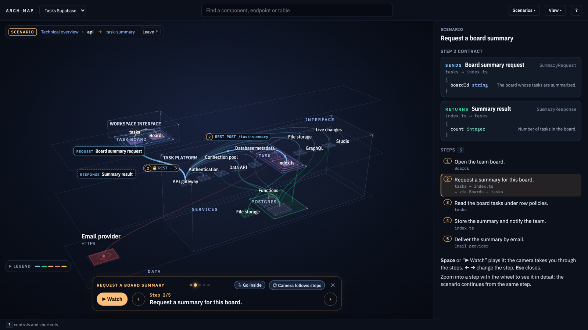

# arch-map — an architecture map

An interactive 3D map of a system, generated from its code: from the client layer (actors and systems) down to
components, endpoints, tables and contracts. The map is drawn from **specs** — plain JSON documents; an AI agent reads
the same specs. Generators for NestJS backends and Supabase projects (Postgres, Edge Functions, React clients) ship
with it, and a new stack is a module that writes the same spec format.



arch-map is a core plus **stack adapters**. The core (viewer, spec format, checks) knows no particular system; a
**project** is a folder that says which code to read and what to show. Adding a project does not touch the core.

## Quick start

Requirements: Node.js 22.18 or later (the TypeScript runs through Node's type stripping, no build step) and a browser
with WebGL 2. arch-map is used from a checkout of this repository; there is no CLI package to install.

```bash
git clone <this repository> arch-map && cd arch-map
npm ci
npm run viewer               # http://localhost:4848 — opens the example projects in examples/
```

The examples are small invented systems, one per stack, with their specs committed:

| Example | Stack | What it shows |
|---|---|---|
| `examples/library-nest` | NestJS backend + a frontend | modules, endpoints, tables, an event bus, outside systems |
| `examples/tasks-supabase` | Supabase (Postgres, Edge Functions) + a React client | tables with RLS, functions, client calls, a client layer with a scenario |

Switch between them in the header, or open one directly with `?project=<name>`.
Offline (a demo at a meeting): `npm run viewer:build && npm run viewer:preview` — fonts, three.js, specs and contracts
are local, nothing goes out to the network.

## How it works

```
your code (read-only) → <project>/generate.ts (a stack adapter) → <project>/specs/*.json ┐
by-hand overlay (client layer, scenarios, envelopes) → <project>/specs/*.json            ├→ check-specs → publish-specs → viewer/
committed snapshots (database schema, contracts) → generator                             ┘
```

Each step reads only the previous step's output; the specs are the only interface between the generators and the
viewer. The core (`viewer/src/core/`: merge, scenarios, Path, “who writes to a table”) is TypeScript without
three.js or the DOM; scripts and the viewer both use it. The decisions behind this: `docs/architecture.md`.

The generators only read the target codebase and never write there. Snapshots hold structure, not data: names, and for a
database also definitions (views, function bodies, cron commands). Secret-like strings are redacted, but that is a
pattern match, not a guarantee: review a snapshot before you commit or share it.

## The map in your own page

The viewer is also a package, `@arch-map/viewer` (`packages/viewer/`, built with `npm run lib:build`): `mount(element,
{ specsUrl })` draws the whole map into that element's shadow root and `destroy()` removes it; a `<arch-map>` element
and a React wrapper sit on top, and a single script (`arch-map.iife.js`, three.js bundled) works from a plain HTML page.
The site itself is the package's first user (`viewer/src/site.ts`). Install, options and examples: `docs/embedding.md`.

## Your own project

Point arch-map at a projects directory (`ARCH_MAP_PROJECTS` in `.env.local`; unset, it uses `examples/`). Each project
is a folder with a `project.json` (schema `specs/schema/project.schema.json`) next to its generator and config.
`docs/adding-a-project.md` walks through it; `docs/adding-a-stack.md` covers a new technology.

## Commands

| Command | What it does |
|---|---|
| `npm run viewer` | copies the specs to `viewer/public/specs` and starts the dev server on :4848 |
| `npm run viewer:build` / `viewer:preview` | a static build in `viewer/dist`; serves it on :4848 (works offline). `viewer/dist/licenses/` holds the license texts of what it bundles (three.js, the fonts, arch-map): keep it when you serve or redistribute the build |
| `npm run gen -- <project>` | generates one project from code (`project.json#generate`), checks it, copies it for the viewer; without a project it lists them |
| `npm run snapshot -- <project> [<kind>]` | refreshes a committed input of a project (database schema, OpenAPI document) |
| `npm run check` | every project as a set of its own (`-- <project>` for one): schema, merge, overlay references, scenarios, contracts, envelopes; errors as `file:line: … (id)` |
| `npm run check:boundary` | without facets the specs are still valid and every core question gets the same answer |
| `npm run check:determinism` | each generator runs twice: byte-identical outputs, target repositories unchanged (needs the target checkouts) |
| `npm test` | unit tests (`test/*.test.ts` and each project's `test/`) |
| `npm run test:browser` | browser checks in a real Chromium with real input; slow, not part of `check:all` — `docs/browser-checks.md` |
| `npm run lib:build` / `lib:pack` | builds the package `@arch-map/viewer` into `packages/viewer/` (ESM, IIFE, types, fonts, schemas); `lib:pack` also lists what `npm pack` would publish — `docs/embedding.md` |
| `npm run check:all` | every check above except determinism, the browser checks and the package build, plus code quality: types, `tsc`, lint, complexity ratchet, import rules, neutrality — `docs/code-quality.md` |

## Specs

The map and the agents read **spec documents**: JSON validated by `specs/schema/spec.schema.json` (JSON Schema 2020-12).
The format, with examples for agents (including `jq` queries): `specs/README.md`.

The core of the format is stack-neutral: types `actor system app module component endpoint datastore table
external-system job queue bus`, channels `interacts call import read write rest event webhook https smtp trigger schedule
references`. Everything stack-specific lives in optional **facets**. Every element and relation has a provenance:
`extracted` (from code, with a file:line link), `declared` (from the project config), `authored` (by hand).

The layers of the map are the specs' tiers: people, interfaces, services, data unless a document declares its own
list (`tiers`). A bus, a queue or jobs are not a layer: each is a rail along the front of its column, a little below its
tier, and events go through it — publisher → bus → subscriber.

### Editing a hand overlay

What the code cannot tell — the client layer — is written by hand in a document that `requires` the generated ones:

- **Systems** (`type: system`) take apps and databases through `contains`; every app and every database belongs to
  exactly one system. Names are for the reader: “Website”, “Backend”.
- **Actors** (`type: actor`) and `interacts` relations actor → system.
- **Scenario** — `scenarios[]`: steps `{ caption, element }` (light a block) or `{ caption, from, to, channel?,
  contract? }` (a relation; every relation between descendants of `from` and `to` on that channel matches). An edge
  step must have a contract — on the relation, on the endpoint or in the step itself. Any step may set `duration`
  (seconds on screen when the scenario plays itself; by default 5–10 s by the caption's length).
- **Envelopes** — `envelopes`: key = contract document + pointer (`contracts/api.openapi.json#/components/schemas/CreateOrderDto`),
  value = `{ title: "Order", fields: { "<field>": "<human name>" } }`.
- **Rename an external system** — `overrides: { "<id>": { name, description } }`.

After an edit — `npm run check`: a broken reference fails with `<file>:<line>: … (<id>)`. Then reload the page of
`npm run viewer` (the specs are copied on start; with the server running — `node scripts/publish-specs.ts`).

## Controls

One depth model — the focus. On opening you see the **client layer**: actors on top, below them the systems
and the external systems. The **technical overview** (a button above the
map or `#v=tech`) opens every system at once.

- **Go inside** a block: the wheel (autofocus), double-click, “Enter ⤵” on the card or in the panel (a tap on a touch screen brings up the card), the Enter key on a selected block, search; the camera flies in and frames the opened block, as the wheel does. **Leave**: zoom out with
  the wheel, Esc, the breadcrumbs above the map, or the browser's **Back**.
- **The wheel goes to what is under the cursor.** A closed block under the cursor opens, even outside the current
  focus; the cursor on an open board outside the focus moves the focus there after ~0.45 s of zooming (a “⇄” ring on
  its name). A wheel notch is spread over ~¼ s, so nothing far from the cursor jumps; opening and leaving a block is
  one smooth motion: the tile grows into the open board in place, its parts grow out of it.
- **Camera**: drag — pan; Shift + drag or the right button — rotate; the wheel — towards the cursor.
- **Keyboard on the map** (Tab to it): ← → select the previous / next block on the map in reading order (rows top to
  bottom, each left to right), ↑ ↓ a block of the row above / below, Home / End the first / last — a ring on the block,
  the selection said to a screen reader («Task platform, system, 27 parts, 5 endpoints, 2 of 3»); Enter goes into the
  selected block, or on a block with nothing inside brings its details in the panel into focus; Esc steps back (in the
  panel it also returns to the map); Shift + arrows pan, + / − zoom as the wheel; Tab goes on to the panel. With a
  scenario open ← → step it and ↑ ↓ still select.
- **Trackpad**: pinch — zoom to the cursor with the same thresholds as the wheel (one gesture never falls through a
  level) and never zooms the page itself; a sideways two-finger swipe pans the map; a purely vertical two-finger
  scroll cannot be told from the wheel — it zooms, pan by dragging then.
- **Hover** a block or its name — a card: what it is, its callers and calls, endpoints, tables, targets and calls (the
  same figures and words as the panel); on a relation — its envelopes. The card stands beside its block and its name, on
  the side that hides least of the other blocks and names. It waits while the
  pointer heads for it (to reach its buttons); moved anywhere else, onto another block, it gives way at once. When the
  wheel or a flight moves another block under a still pointer, the hover follows once the camera rests.
- **Click** — the panel: “Used by” (callers · calls), “Tables”, “Talks to” (targets · calls), endpoints with contracts,
  “Code details”. While a block is selected the other names stay, dimmed.
- **First panel** — the project, a one-line summary, the main scenario's “▶ <title> (N steps)” button, “How to look”;
  the spec documents and their commits are folded under “Sources”.
- **?** (or the “?” button in the header) — every control and shortcut, from any state; Esc closes it.
- **Status line** (under the map) — how many relations the legend's filters hide now and how many calls the specs
  could not resolve (shown when not 0); the renderer's counters are on the debug API, `archMap.stats`.
- **Path ▶** (on an endpoint, a component, from a search for an endpoint) — the call chain by method down to tables,
  events and external systems: step numbers on the map and a tree in the panel; “break: …” — where static analysis
  cannot see the call.
- **Search** — a component, an endpoint (a route such as `/orders/:id`) or a table.
- **Scenarios ▾** — a scenario: ←/→ — a step back/forward, below the map “Step n/N — caption”; pulses run along
  the step's relations and its envelopes show (the request at the caller, the response at the callee). Esc — close.
  - **⤵ Go inside** (on by default): each step opens the blocks it happens in and is shown on its own components (a
    controller, a service, a table), not on the system that holds them. Off — the step plays on whatever is open.
  - **◎ Camera follows steps** (on by default): the camera frames every step; off — it only pans when the step is out
    of frame. Both choices are remembered.
  - **▶ Watch** (or Space, or “▶” in the overview) — the cinema: the interface steps aside, letterbox and subtitles,
    a title card with an establishing shot, then requests, processing and returns in causal order. Nested calls
    return before their caller continues; gateway hops are visited in reverse on the return. Captions and step
    numbers stay as authored. Space pauses at the current position and resumes the remaining journey (taking the
    camera with the mouse or wheel pauses too); ←/→ seek steps, F enters full screen, Esc leaves.
  - **The way between steps**: only supported, unambiguous connections are followed. Independent actions are
    introduced explicitly; missing connections say “Connection unspecified”. Returns without an authored response
    schema say “Return of control · payload unspecified”. Events follow the matching topic to scenario-relevant
    handlers, with a fork overview for multiple branches; camera visits do not imply subscriber execution order.
    Moving attention back to a topic sends no reply. Webhooks, schedules, imports and interactions do not
    automatically generate responses.
  - **The contract of a step**: on a step between systems a card shows the shape of the object it sends (and the one
    it gets back) — every field with its contract type, `*` for required, the client layer's name, and an object
    field's own first fields. In the cinema the current direction’s card stands on the right; otherwise both sides are in the panel.
- **Envelopes** — what travels on a relation (an order, a payment): shown on scenario steps and on the selected and
  hovered relation; zoomed in they open to 5–7 fields and “N more”. A click on an envelope lights every relation that
  carries it.
- **View ▾** — angle, coloring, space between layers, autofocus, pulses, glow, camera and layout motion. With the system's **reduce motion** setting, pulses and motion start off (flights and level changes are cuts, the cinema waits for ▶); the checkboxes turn them back on. **Legend** — protocols; a click hides
  their relations.
- **Links and history**: the address keeps the view, the focus, the selection, the path and the scenario step
  (`#v=tech&f=…&s=…&p=<id>|<method>&sc=<id>:<step>`). A new place (another focus, a path, the view, a scenario opened
  or closed) is a browser history entry — Back and Forward move between places and the camera flies there; a
  selection or a scenario step only replaces the entry.
- **Project switcher**: the header lists project titles in manifest order when at least two projects are available. Choosing one opens its map and clears the document override and deep link; Back returns to the previous project. The page title follows the project.
- Page parameters: `?project=<name>` — another project instead of the default one; `?docs=client.json,backend.json` — these documents of a project instead of its open set (the project is found by the names, which are unique across projects; documents of two projects at once are an error); `?nofacets=1` — without facets (the boundary check).
- Light look (e.g. a map embedded in a light documentation page): `?theme=light` (or `theme.base: "light"` in the project's `project.json`); dark stays the default. Colors as hex without `#`: `?accent=F4263D` (selection, buttons, links; `?accent2=` its deeper variant for fills under text), `?bg=`, `?panel=`, `?panel2=`, `?fg=`, `?muted=`, `?line=`, `?step=` (scenario steps); fonts `?font=Manrope`, `?mono=JetBrains%20Mono` (both bundled with IBM Plex). The same in `project.json`: `"theme": { "base": "light", "colors": { "bg", "panel", "panel2", "fg", "muted", "line", "accent", "accentStrong", "step" }, "fonts": { "ui", "label", "code" } }` (schema `specs/schema/project.schema.json`); the page's parameters win, and colors given for one base are dropped when the page asks for the other. Block and relation colors are deepened automatically on light (`viewer/src/theme.ts`); the glow is off there by default (View → Glow).

Autofocus (checked with a real wheel in Playwright): a closed block under the cursor opens when it covers ~3.5% of the
frame; right after entering, its parts open only once they have grown twice again. The focus closes when it has shrunk
to 30% of its size after entering; a “Zoom out more” hint shows beforehand. With a mouse in headless Chromium: ~6
notches per level zooming in, 4–7 zooming out; a headed Chromium needs about half as many.

Debug API in the console: `window.archMap` (the site's map's `probe`; an embed gets it as `handle.probe` with
`debug: true`): `project` (the current project name), `root` (the map's shadow root), `expandAll()`, `counts()`,
`scenario(id, step)`, `cinema` (`enter`, `pause`, `resume`, `go`, `exit`, `state`), `setView('tech'|'client')`, `frames`
(frames drawn — it does not grow at rest), `model`, `state`, `scene`.

## What is where

| Path | What |
|---|---|
| `examples/<project>/` | the example projects: `project.json`, `config.ts`, `generate.ts`, `snapshot.ts`, `target/` (the small invented codebase it maps), `specs/`, `test/` |
| `scripts/stacks/{nest,supabase}/` | the stacks (what a kind of system looks like: scan, spec builder, snapshots); ids and values come from the project config they are handed |
| `scripts/lib/` | shared code of the extractors and checks: spec I/O, spec sets, the project manifests (`projects.ts`), the facet guard |
| `scripts/run.ts`, `scripts/check-*.ts`, `scripts/publish-specs.ts` | the `gen` / `snapshot` runner, the checks and the copy of the specs for the viewer; they name no project (`check:neutral`) |
| `types/` | shared types: `spec.d.ts` (generated), `core.ts`, `generator.ts`, `stacks/*.ts` (stack config interfaces), `project.ts`, `viewer.ts`, `scene.ts` |
| `viewer/src/core/` | the core: merge, scenarios, tiers, Path, queries |
| `viewer/src/spec-adapter.ts` | specs → the viewer's model; the only place that reads facets (besides “Code details”) |
| `viewer/src/scene.ts`, `scene-*.ts`, `layout.ts`, `shapes.ts`, `input.ts` | the three.js scene (`scene.ts` the façade; `scene-controls` wheel and pinch, `-camera` flights and cinema shots, `-labels` level of detail, `-pick` pointer and screen geometry, `-layout` level-change motion, `-edges`, `-style`, `-frame`), layout by tiers and columns, shapes, wheel and trackpad rules |
| `viewer/src/index.ts`, `options.ts`, `host.ts`, `markup.ts`, `element.ts`, `react.ts` | the package: `mount` (options, the spec check, the shadow root with the inlined `style.css` and the markup), `<arch-map>`, the React wrapper |
| `viewer/src/site.ts`, `main.ts`, `projects.ts`, `fonts.ts` | the site: picks the project (`projects.json`, `?project=`, `?docs=`, `?theme=`) and mounts the map with the URL, page keys and `window.archMap` |
| `viewer/src/map.ts`, `app.ts`, `card.ts`, `menus.ts`, `probe.ts`, `focus.ts`, `view.ts`, `bars.ts`, `play.ts`, `cinema.ts`, `history.ts`, `actions.ts`, `map-keys.ts`, `roving.ts`, `load.ts`, `panel.ts`, `scenario.ts`, `envelopes.ts` | one map's controller (`map.ts` wires; the parts share the per-map `app` context of `app.ts` — its root, listeners' signal, options, theme and state; `map-keys.ts` the map's keyboard over the reading order of `roving.ts`), the hover card, the menus, the debug API, the panel, scenarios and the cinema, envelopes |
| `test/` | generic unit tests (synthetic fixtures) and browser checks; a project's own tests are in its `test/` |
| `packages/viewer/` | the publishable package (`package.json`, README; `dist/` and `schema/` are built) |
| `docs/` | `architecture.md`, `code-quality.md`, `browser-checks.md`, `embedding.md`, `adding-a-stack.md`, `adding-a-project.md` |

## Limitations

- Path is static analysis: dynamic calls and classes outside dependency injection break the chain; what a generator could not
  resolve is written to its `*.unresolved.json` report, never guessed.
- Scenario steps do not name methods: an edge step lights every matching relation between the blocks.
- Event mechanisms outside the supported ones (for example Socket.IO) are not extracted.
- Pinch is checked by replaying Chrome events; a live trackpad check is manual.
- The viewer needs WebGL 2 and a GPU-backed browser for comfortable frame rates on large maps.

## Contributing

See [CONTRIBUTING.md](CONTRIBUTING.md); security reports: [SECURITY.md](SECURITY.md); changes: [CHANGELOG.md](CHANGELOG.md).

## License

MIT — see [LICENSE](LICENSE).
