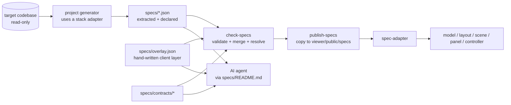
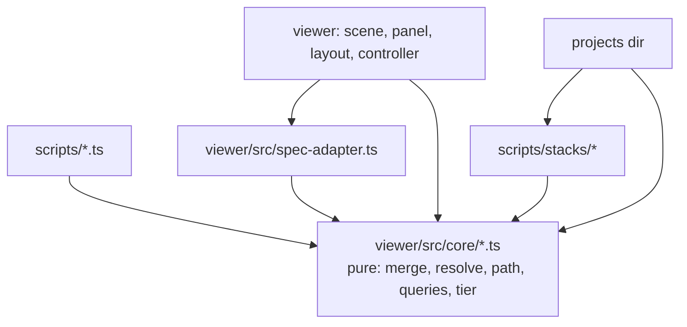

# Architecture

The decisions that keep arch-map's parts consistent: generators written by different people, one viewer, and AI agents that
read the same data. Each decision has an id (`AD-n`) that code comments refer to. The format is *context, decision,
consequence*. This document describes the current state.

## Paradigm

**Pipes and filters with one file-based contract.** Each stage reads only the previous stage's output; **spec documents**
(JSON) are the single interface between the generator side and the viewer side, and the same documents are what an
agent reads.

Dependencies point down only:

`viewer/src/core/` imports nothing from three.js, the DOM or Node. There is one implementation of merge, scenario
resolution, Path and "who writes Y"; scripts and the viewer both use it. `.dependency-cruiser.cjs` enforces the layers
(`npm run check:arch`).

## Decisions

### AD-1 — Spec documents: a file contract with a version

- **Context.** Several generators and a viewer must agree on what a document is, without sharing code paths.
- **Decision.** A spec document is a JSON file validated by `specs/schema/spec.schema.json` (JSON Schema 2020-12,
  `$id: "arch-map:spec:1"`). Every document has the shape `{ schemaVersion, id, title, requires?, repos?, tiers?, glyphs?,
  elements[], edges[], scenarios?, envelopes?, overrides? }`. Edges and `contains` may reference only ids of the same
  document or of documents named in `requires`. Scenarios, envelopes and overrides are client-layer references and are
  checked against the whole merged set. `schemaVersion` is semver; the viewer accepts only the major it knows and
  otherwise shows an "Incompatible spec version" notice instead of a map. Where documents live is AD-16.
- **Consequence.** Any producer that writes valid documents works with the viewer and the checks. A `?docs=` subset in the
  viewer drops, with a console warning, client-layer items whose targets are absent; the checks never drop, they fail.

### AD-2 — One validator, a closed core

- **Context.** Two validators with different strictness would disagree about what is valid; stack concepts would leak into
  the core.
- **Decision.** Validation uses `ajv` 8 (`Ajv2020`, `allErrors: true`) against the schema, in `scripts/lib/spec-io.ts` only.
  A generator validates in memory and does not write an invalid document (exit 1). Core objects (document, element, edge,
  method, column, source, contract, access, scenario, step) are `additionalProperties: false`; only `facets.*` values and
  `envelopes.*` are open. The schema uses no `format` keywords; it uses `pattern`. Rules that must hold are in the schema,
  not only in scripts: id and edge-id patterns, the type and channel enums, `parent: null` for every `app` and
  `datastore` (AD-8), `tier` required on `app`.
- **Consequence.** A stack cannot invent a core field; stack detail goes into facets (AD-4).

### AD-3 — Core element types and fields are stack-neutral

- **Context.** Words such as `controller`, `repository` or `rpc` belong to a technology, not to every system.
- **Decision.** `element.type` is one of `actor system app module component endpoint datastore table external-system job
  queue bus`. Fields: `id`, `type`, `parent` (`null` for roots), `name`, `description`, `technology` (a label, never logic),
  `tier`, `provenance` (`extracted | declared | authored`), `context` (outside the slice), `source`, `derivedFrom` /
  `confidence` (inferred groupings), `methods` (components), `handler` / `http` (endpoints), `columns` (tables),
  `access`, `contract`, `contains` (systems), `facets`. Endpoints are children of the component that serves them.
- **Consequence.** The viewer and the checks work on any stack. A new stack adds facet keys, not types.

### AD-4 — Channels and method-level edges

- **Context.** "What happens when this method runs" must not depend on facets, and read/write must have one encoding.
- **Decision.** `edge.channel` is one of `interacts call import read write rest event webhook https smtp trigger schedule
  references`. Calls, data access, events and outbound HTTP are emitted **per method** (`fromMethod` set), so Path is a
  pure walk over core edges: `call`/`event` recurse into `to#toMethod`; `read`/`write`/`https`/`smtp` are leaves; a
  method's `unresolved[]` entries become explicit "break" steps. A call to a sibling method is an edge with `from === to`.
  `ops` has one meaning per channel (data-access call names for `read`/`write`; FK field names for `references`; client
  methods for `https`/`smtp`). `sites` keeps every call site when several collapse into one edge. Read and write are
  separate edges, never "both". Facets are keyed `stack.kind` (`^[a-z0-9]+\.[a-z0-9-]+$`) and hold free objects.
- **Consequence.** Path, "who calls", "who writes" and scenarios are answerable without any facet; removing all facets
  changes nothing about them (`npm run check:boundary` proves it).

### AD-5 — Provenance and source references

- **Context.** A reader must be able to tell code facts from configuration and from prose, and to open the code.
- **Decision.** The document lists `repos: { key: { url, commit, blob } }`, where `blob` is a URL template with `{file}` and
  `{line}`. `source` is `{ repo, file, line }` (code) or `{ config: "<config path>#<export path>" }` (declared). Every
  `extracted` element and edge has a code source; `declared` items have a config source; `authored` items may have either
  or none. The viewer builds links only by filling `blob`.
- **Consequence.** Every claim on the map links to its origin or says it is declared or authored.

### AD-6 — Stable ids

- **Context.** Hand-written references, deep links and diffs break when ids change between runs.
- **Decision.** An element id matches `^[a-z][a-z0-9_]*(\.[a-z0-9_]+)*$`; segments come from names by camelCase → snake. A
  project's extracted ids carry one root prefix of its choice (`<prefix>.api.<folder>.<module>.<class>`). An endpoint id is
  `<component id>.<http method lower>_<path as snake>`. An edge id is `<from>[#<fromMethod>]><to>[#<toMethod>]:<channel>`.
  Ids are unique across all merged documents of a project. In URL hashes ids are `encodeURIComponent`-encoded; a Path link
  is `<component id>|<method>`.
- **Consequence.** Regenerating does not rename anything, so overlays, links and scenario steps keep working.

### AD-7 — Contracts

- **Context.** What travels on a relation should be shown once, from the source of truth, not copied.
- **Decision.** Contracts live next to the specs under `contracts/`: REST is the backend's own OpenAPI export as it is;
  everything else is hand-written JSON Schema 2020-12 with `$defs`. `contract = { doc, operationId?, request?, response? }`
  with JSON pointers local to `doc`. REST contracts sit on the **endpoint**; an edge's effective contract is its own, else
  its target endpoint's, computed only by `effectiveContract()` in `core/resolve.ts`. `request` and `response` point to a
  named schema; when an operation inlines a `$ref`, the generator stores the referenced schema's pointer. The same object is
  the same `doc + pointer`.
- **Consequence.** "Where else does this shape travel" is a lookup by `doc + pointer`.

### AD-8 — Client layer and system ownership

- **Context.** Generated apps must not depend on hand files, and there must be exactly one way to parent an app.
- **Decision.** In every document `app` and `datastore` elements have `parent: null` (schema-enforced). A `system` element
  claims them with `contains: [ids]`; `core/merge.ts` is the only writer of their parent. After merging, every `app` and
  `datastore` must be claimed by exactly one system (checked only when at least one system is loaded); a second claim fails.
  `external-system`, `actor` and `system` stay roots. A client-layer document may override another element's display
  `name`/`description` through `overrides` — the only place one document touches another's element.
  A scenario is `{ id, title, steps: [ { caption, element } | { caption, from, to, channel?, contract? } ] }`. An edge
  step resolves to all core edges whose `from`/`to` are the given elements **or their descendants**, filtered by channel;
  zero matches is dangling, and every edge step needs an effective contract. `envelopes` map a `doc + pointer` to
  `{ title, fields }`; the check fails on a key that does not resolve to a schema.
- **Consequence.** A generated document is complete on its own; the hand overlay adds the picture a person wants to see.

### AD-9 — Access and the row-level-security lock

- **Context.** Authorization appears as endpoint guards in one stack and as row-level policies in another.
- **Decision.** `access = { level: public|authenticated|restricted, roles?, guards?, policies? }`. The effective access of an
  edge is its own, else its target endpoint's (`core/resolve.ts`). Row-level policies go on the `read`/`write` edge from the
  app or function to the table; the viewer draws a lock on such an edge iff its effective `access.policies` is non-empty.
  Policy text goes into a facet.
- **Consequence.** The core has no stack-specific "rls" flag; the lock is derived from a core field.

### AD-10 — Determinism and a read-only target

- **Context.** Diff noise hides real changes, and a generator that writes into the codebase it reads is dangerous.
- **Decision.** All spec JSON is written by `writeSpec()` in `scripts/lib/spec-io.ts`: elements sorted by `id`, edges by `id`,
  arrays in a documented order, object keys sorted recursively, 2-space indent, trailing newline, no timestamps. Time,
  duration and counts go to `*.meta.json` (gitignored). Nothing in arch-map writes into a target codebase; a snapshot holds
  structure, never data. `npm run check:determinism` regenerates twice and compares bytes, and checks that the target is unchanged.
- **Consequence.** A diff of specs is a diff of the architecture.

### AD-11 — Layout: tiers and system columns

- **Context.** Every viewer and agent must place the client layer the same way, and layout must not read facets.
- **Decision.** The layers are top-down `people`, `ui`, `service`, `data` unless a document declares its own `tiers` (one
  list for the whole merged set). An element's tier is its own `tier`, else its parent's, else by type (`actor` → people,
  `datastore`/`table`/`external-system` → data, the rest → service); a `system`'s tier is the topmost of its parts. Tier is
  computed once, by `tierOf()` in `core/tier.ts`. Actors form one centered row; every other root is a **column**, ordered by
  document order, then element order. A collapsed system is one block on its tier; an expanded one shows its children packed
  in the cell of each child's tier. `bus`, `queue` and `job` are not a layer: each is a rail along the front of its column,
  a little below its tier. The client layer opens with nothing expanded; `#v=tech` opens every system.
- **Consequence.** A new stack gets a sensible picture without any viewer change.

### AD-12 — The viewer reads specs through one adapter

- **Context.** Facet or stack knowledge scattered through scene and panel code makes every new stack a viewer change.
- **Decision.** The viewer loads a project's documents and contracts, merges them (`core/merge.ts`), and `spec-adapter.ts`
  turns the merged set into the internal model. The adapter folds endpoints into their component (the single rule: it keeps
  `endpointOwner`, retargets edges to the component while keeping `edge.endpoint`, and every id lookup in the viewer goes
  through `nodeOf(id)`), builds edge `items` for the panel, and groups edges for the legend. The **only** facet readers are
  the adapter's `shapeOf()` and the panel's generic "Code details" list. `?nofacets=1` strips facets in the adapter, which is
  the browser half of the boundary test.
- **Consequence.** The viewer's code names no stack-specific facet (`check:neutral` enforces it for the facet keys the
  specs of the active projects use).

### AD-13 — Glyphs: declared by the stack, core fallback

- **Context.** An element with a facet should look like what it is, but a table of facet keys in the viewer would make every
  new stack edit generic code.
- **Decision.** A document may declare `glyphs: [{ facet, shape, role }]` (schema 1.3). `shape` is an enum of the viewer's
  glyphs, so a typo fails `npm run check`; `role` is the word on the card. The merged set keeps one ordered list (documents in
  load order); a facet declared twice in one document is an error, declared differently in two documents is an error when
  strict (a warning in `?docs=` subsets, the first wins). `shapeOf(el, glyphs)` takes the first declaration whose facet the
  element carries, else a fallback by core type (`actor` → person, `system`/`app`/`module` → matrix, `component` → core,
  `datastore` → matrix, `table` → grid, `external-system` → orbit, `job` → clock, `queue` → stack). A stack declares its list
  next to the code that emits the facets (the Nest stack: `scripts/stacks/nest/glyphs.ts`).
- **Consequence.** Glyphs are stack data. Display only: no core question depends on them.

### AD-14 — The agent file

- **Context.** An agent should learn the format from one place, not from the viewer's source or its published copies.
- **Decision.** `specs/README.md` describes the format for agents: element and edge field tables, channel meanings,
  provenance, context and confidence, how to answer "who calls X / who writes Y" with `jq`, contract pointer resolution, and
  that facets are optional detail. `viewer/public/specs/` is a gitignored copy made by `scripts/publish-specs.ts`.
- **Consequence.** The format has one human-readable description next to the schema.

### AD-15 — Input: pinch and two-finger scroll

- **Context.** Trackpads send pinch as `ctrlKey` wheel events. three.js's `OrbitControls` multiplies such a delta by ten, so
  one pinch could fall through several zoom levels.
- **Decision.** `MapControls` (`viewer/src/scene-controls.ts`) subclasses `OrbitControls` and overrides `_customWheelEvent`: for
  a pinch it clamps the boosted delta so one event never exceeds one mouse notch and caps the summed delta per 100 ms at one
  notch; other events pass through. A sideways two-finger swipe (no `ctrlKey`, `deltaX !== 0`) pans. The rules are pure and
  in `viewer/src/input.ts`. A purely vertical two-finger scroll cannot be told from a wheel and zooms; pan by dragging.
  Mouse behavior is the acceptance baseline (about six notches per level in, four to seven out).
- **Consequence.** The override depends on three.js internals (`_customWheelEvent`, `_controlActive`); bumping three
  requires re-running the pinch browser check (`docs/browser-checks.md`).

### AD-16 — Projects: one folder and one manifest per project

- **Context.** A second codebase must not need a change to the scripts or the viewer, one project's files and checks must not
  break another's, and the core must name no project.
- **Decision.**
  - A **project** is a folder `<projects dir>/<name>/` with `project.json` (schema `specs/schema/project.schema.json`, read
    only through `scripts/lib/projects.ts`): `documents` (load order), `open` (what the map opens with), `idPrefixes`, `env`,
    `generate`, `snapshots`, `determinism`. The projects dir has `index.json` (the default project and the switcher order).
    Everything that knows one project lives in its folder: `config.ts` (exports `CONFIG_SOURCE` and `DOC`, and satisfies its
    stack's config interface from `types/stacks/`), `generate.ts`, snapshot scripts, `sources/` (committed
    snapshots), `test/`, and `specs/` (documents, `contracts/`, reports, a README).
  - The projects dir is chosen by env `ARCH_MAP_PROJECTS` (absolute, or relative to the checkout); unset, it is `examples/`.
    Zero projects is a valid state. The folder can live anywhere: project code finds its files from `import.meta.url`, and
    the paths the specs record (provenance) are strings built from the config, not disk paths.
  - A **stack** (`scripts/stacks/{nest,supabase}/`) says how a kind of system is scanned and turned into specs. It takes
    every id root, name and value from the project config it is handed (its interface is in `types/stacks/<stack>.ts`).
  - The generic core (`scripts/`, `viewer/src/`, `types/`, `test/*.ts`, the root configs) names no project: `npm run
    check:neutral` reads the manifests and fails on a project name, id root or env var there.
  - Project code imports the core only by package name — `arch-map/stacks/<s>`, `arch-map/generator`, `arch-map/testing`,
    `arch-map/core`, `arch-map/viewer/<module>`, `arch-map/types/<file>` (`package.json` `exports`; `check:arch` enforces it).
    Stacks import only `scripts/lib/`, the core and `types/`; a project imports stacks, lib, core and types and never another
    project; the generic code never imports a project (`scripts/run.ts` spawns a project's scripts as child processes).
  - `npm run gen -- <project>` and `npm run snapshot -- <project> [<kind>]` are the only entry points to generators and
    snapshots; the checks run per project (a project is checked as a set of its own; document names are unique across
    projects so `?docs=` finds its project, and an element id in two projects is a warning); the viewer opens the default
    project, `?project=<name>` another, `?docs=` a subset, and has a project switcher.
- **Consequence.** Adding a project is a folder and an entry in `index.json`; `check:neutral` and `check:arch` prove the core
  did not change (`docs/adding-a-project.md`).

## Conventions

| Concern | Convention |
|---|---|
| Language | English everywhere: UI, docs, comments, generator strings. Text that comes from the target code (OpenAPI descriptions, JSDoc) stays as written there. |
| Code | TypeScript throughout, run on Node ≥ 22.18 by type stripping with no build step; the viewer is Vite + three.js. Shared shapes live in `types/`, not in JSDoc. |
| Errors (scripts) | `<file>:<line>: <message> (<id>)` on stderr, exit code 1; all errors are collected before exiting. The line of an id in a hand JSON file is the first line containing `"<id>"`. |
| Errors (viewer) | a notice or a toast, never a blank screen. |
| npm scripts | `gen` = generate → check-specs → publish-specs; `check` = check-specs; `check:boundary`; `check:determinism`; `viewer` = publish-specs → vite (committed specs are enough; no target checkout needed). |
| Debug API | `window.archMap` (the site's map's `probe`; `mount(el, { debug: true }).probe` in an embed): `project`, `root`, `expandAll()`, `counts()`, `frames`, `scenario(id, step)`, `cinema`, `setView()`, `model`, `state`, `scene`. |

## Stack

| Name | Notes |
|---|---|
| Node.js | ≥ 22.18 (type stripping, `--env-file-if-exists`) |
| three | pinned (see AD-15) |
| vite | pinned |
| ajv | JSON Schema 2020-12 validation (AD-2) |
| typescript | compiler API in the Nest and Supabase generators |
| dependency-cruiser, ESLint | layer and style rules (`docs/code-quality.md`) |
